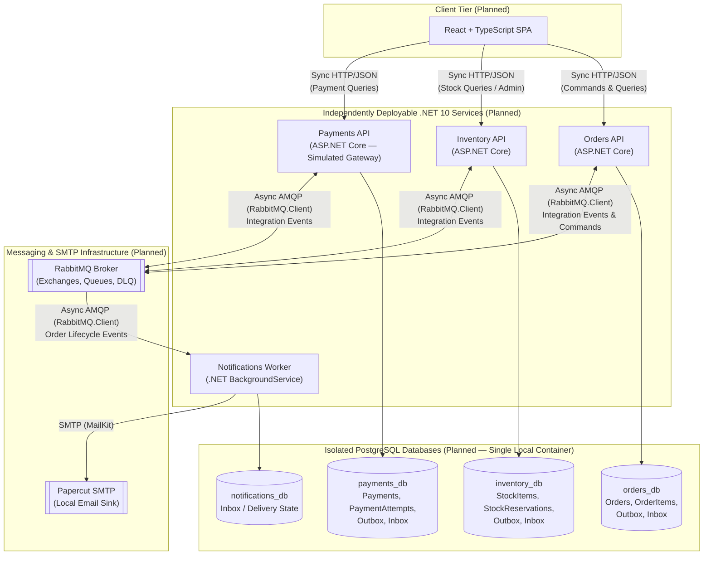

# Architecture Overview

## 1. Purpose & Current Implementation Status

OMS is an educational Order Management System designed to develop and demonstrate senior-level software engineering competencies in modern .NET 10 distributed SaaS applications.

> **Current Implementation Status**:
> - **Implemented**: Repository engineering baseline (`Oms.slnx`, `Directory.Build.props`, `Directory.Packages.props`, `.editorconfig`), documentation, and Devin AI agent workflow.
> - **Planned (Not Yet Implemented)**: All four deployable services (`Orders`, `Inventory`, `Payments`, `Notifications`), `.csproj` assemblies, PostgreSQL databases, RabbitMQ messaging topology, Papercut SMTP integration, Docker Compose orchestration, and the React frontend described below are **architectural designs and proposals**. No application code or infrastructure exists yet.

---

## 2. Confirmed Architectural Baseline ([ADR-0001](adr/0001-independent-service-boundaries.md))

The following foundational decisions have been approved by the human engineer and recorded in [ADR-0001](adr/0001-independent-service-boundaries.md):

1. **Four Independently Deployable Services**:
   - **Orders** — ASP.NET Core Web API
   - **Inventory** — ASP.NET Core Web API
   - **Payments** — ASP.NET Core Web API (using simulated payment processing)
   - **Notifications** — .NET Background Worker (sending emails via `MailKit` and `Papercut SMTP`)
2. **Incremental Implementation**: Services are built, tested, and verified one service at a time.
3. **Strict Service Boundaries & Data Ownership**:
   - No shared domain entities across services.
   - No cross-service database relationships, foreign keys, or shared tables.
   - Independent logical PostgreSQL databases per service (`orders_db`, `inventory_db`, `payments_db`, and `notifications_db` where persistent state is required).
   - During local development, a single PostgreSQL container may host these isolated databases.
4. **Technology & Pattern Constraints**:
   - .NET 10 / C# 14, Entity Framework Core, PostgreSQL, MediatR for in-process CQRS, `RabbitMQ.Client` for asynchronous messaging, `Microsoft.Extensions.Http.Resilience` for HTTP resilience, OpenTelemetry, xUnit + Testcontainers, Docker & Docker Compose (and Redis / Kubernetes in later stages).
   - Transactional Outbox, Inbox, idempotency, and explicit failure handling wherever reliable distributed messaging requires them.
   - Pragmatic Clean Architecture and DDD without speculative abstractions.
5. **Explicit Exclusions**:
   - **.NET Aspire** (container orchestration and OpenTelemetry wiring are configured explicitly).
   - **MassTransit** (messaging, topology, Outbox/Inbox, and retries are implemented directly with `RabbitMQ.Client`).
   - **Direct Polly API usage** (resilience pipelines are configured through `Microsoft.Extensions.Http.Resilience`).

---

## 3. System Topology Diagram (Planned Architecture)



---

## 4. Service Boundary Definitions

### 4.1 Orders Service (`Oms.Orders.*`) — ASP.NET Core API

- **Primary Responsibilities**:
  - Accept and validate customer order placement requests (`POST /api/orders`) and expose order status queries (`GET /api/orders/{id}`).
  - Own the `Order` lifecycle state machine (`Pending` -> `AwaitingPayment` -> `Confirmed`, or `Cancelled` / `Failed`).
  - Coordinate the order fulfilment workflow by publishing order lifecycle integration events and reacting to inventory and payment outcome events.
- **Explicitly Excluded Responsibilities**:
  - Tracking warehouse stock levels or managing inventory reservations directly.
  - Executing payment authorisations or storing payment gateway audit logs.
  - Formatting or dispatching customer emails.
- **Data Ownership (`orders_db`)**:
  - `orders` and `order_items` tables, plus `outbox_messages` and `inbox_messages` tables.
- **Minimal Anticipated Domain Model**:
  - `Order` (Aggregate Root): `Id`, `CustomerId`, `CustomerEmail`, `Status`, `TotalAmount`, `FailureReason`, `CreatedAtUtc`, `RowVersion` (optimistic concurrency), and a `1..N` collection of `OrderItem`.
  - `OrderItem` (Child Entity within `Order` aggregate): `Id`, `OrderId`, `ProductSku`, `Quantity`, `UnitPrice` (snapshotted at order creation).
- **Expected External Dependencies**:
  - PostgreSQL (`orders_db` via EF Core), RabbitMQ (`RabbitMQ.Client`), OpenTelemetry.
- **Initial Communication Requirements**:
  - **Inbound Sync HTTP**: Client endpoints for placing orders (`202 Accepted` or `201 Created` with initial `Pending` status) and querying order state.
  - **Outbound Async RabbitMQ**: Publishes `OrderPlaced`, `OrderConfirmed`, and `OrderCancelled` integration events via its Transactional Outbox.
  - **Inbound Async RabbitMQ**: Consumes `StockReserved`, `StockReservationFailed`, `PaymentSucceeded`, and `PaymentFailed` events via its idempotent Inbox.
- **Failure & Consistency Considerations**:
  - Order creation and the initial `OrderPlaced` Outbox message commit atomically in a single `orders_db` transaction.
  - State transitions on `Order` must be idempotent and guarded against out-of-order or duplicate integration events (for example, ignoring a duplicate `StockReserved` event if the order has already advanced).

### 4.2 Inventory Service (`Oms.Inventory.*`) — ASP.NET Core API

- **Primary Responsibilities**:
  - Maintain authoritative stock quantities for products (`StockItem`).
  - Reserve stock for placed orders, release reservations when orders are cancelled or payments fail, and commit reservations when orders are confirmed.
  - Expose HTTP endpoints for querying stock availability and seeding/adjusting stock in development/testing.
- **Explicitly Excluded Responsibilities**:
  - Knowing customer details, order pricing, payment status, or email notifications.
- **Data Ownership (`inventory_db`)**:
  - `stock_items` and `stock_reservations` tables, plus `outbox_messages` and `inbox_messages` tables.
- **Minimal Anticipated Domain Model**:
  - `StockItem` (Aggregate Root): `Id`, `ProductSku` (unique), `QuantityAvailable`, `QuantityReserved`, `RowVersion` (optimistic concurrency). Enforces the invariant `QuantityAvailable >= 0`.
  - `StockReservation` (Child Entity, `1..N` from `StockItem` or keyed by `OrderId`): `Id`, `StockItemId`, `OrderId`, `Quantity`, `Status` (`Reserved`, `Committed`, `Released`), `CreatedAtUtc`.
- **Expected External Dependencies**:
  - PostgreSQL (`inventory_db` via EF Core), RabbitMQ (`RabbitMQ.Client`), OpenTelemetry (and Redis in a later caching stage).
- **Initial Communication Requirements**:
  - **Inbound Sync HTTP**: Read/admin endpoints (`GET /api/stock/{sku}`, `POST /api/stock`) for inspection and test setup.
  - **Inbound Async RabbitMQ**: Consumes `OrderPlaced` (to reserve stock), `OrderCancelled` (to release reserved stock if held), and `OrderConfirmed` (to commit the reservation).
  - **Outbound Async RabbitMQ**: Publishes `StockReserved`, `StockReservationFailed`, and `StockReleased` via its Transactional Outbox.
- **Failure & Consistency Considerations**:
  - Concurrent reservations for the same SKU must be protected by optimistic concurrency (`xmin` / row version) and database `CHECK` constraints (`quantity_available >= 0` and `quantity_reserved >= 0`) so overselling is impossible under race conditions.
  - Reservation handling is idempotent by `(OrderId, ProductSku)`: reprocessing `OrderPlaced` for an order that already holds an active reservation yields the existing outcome without double-deducting stock.

### 4.3 Payments Service (`Oms.Payments.*`) — ASP.NET Core API

- **Primary Responsibilities**:
  - Execute simulated payment authorisation/capture for orders once stock is reserved.
  - Record an immutable audit trail of every payment attempt (`PaymentAttempt`).
  - Expose read-only HTTP endpoints to inspect payment status by `OrderId` or `PaymentId`.
- **Explicitly Excluded Responsibilities**:
  - Managing order line items, reserving stock, or sending emails.
- **Data Ownership (`payments_db`)**:
  - `payments` and `payment_attempts` tables, plus `outbox_messages` and `inbox_messages` tables.
- **Minimal Anticipated Domain Model**:
  - `Payment` (Aggregate Root): `Id`, `OrderId` (unique idempotency key per order), `Amount`, `Currency`, `Status` (`Pending`, `Succeeded`, `Failed`, `Refunded`), `CreatedAtUtc`, `RowVersion`, and a `1..N` collection of `PaymentAttempt`.
  - `PaymentAttempt` (Child Entity within `Payment` aggregate): `Id`, `PaymentId`, `AttemptNumber`, `Status` (`Succeeded`, `Declined`, `GatewayError`), `FailureReason`, `AttemptedAtUtc`.
- **Expected External Dependencies**:
  - PostgreSQL (`payments_db` via EF Core), RabbitMQ (`RabbitMQ.Client`), deterministic/configurable in-process simulated payment gateway, OpenTelemetry.
- **Initial Communication Requirements**:
  - **Inbound Sync HTTP**: Read endpoints (`GET /api/payments/order/{orderId}`) for status inspection.
  - **Inbound Async RabbitMQ**: Consumes `StockReserved` (or a payment request event carrying `OrderId` and `Amount`) to trigger payment processing.
  - **Outbound Async RabbitMQ**: Publishes `PaymentSucceeded` or `PaymentFailed` via its Transactional Outbox.
- **Failure & Consistency Considerations**:
  - **Strict Idempotency on `OrderId`**: If a message is redelivered after a payment has already succeeded, `Payments` must not charge the customer twice; the Inbox and unique constraint on `OrderId` ensure duplicate messages are safely acknowledged.
  - Transient simulated gateway timeouts are recorded as `PaymentAttempt` entries before retrying, whereas deterministic declines (e.g. insufficient funds) immediately transition `Payment` to `Failed` and emit `PaymentFailed`.

### 4.4 Notifications Service (`Oms.Notifications.*`) — Background Worker

- **Primary Responsibilities**:
  - Consume terminal order lifecycle integration events (`OrderConfirmed`, `OrderCancelled`) from RabbitMQ.
  - Render plain-text/HTML transactional emails and dispatch them via `MailKit` to `Papercut SMTP`.
- **Explicitly Excluded Responsibilities**:
  - Owning business domain aggregates, mutating order/stock/payment state, or exposing public business APIs.
- **Data Ownership (`notifications_db`)**:
  - Minimal persistence required strictly for reliable idempotent processing: `inbox_messages` (or `notification_dispatches`) tracking processed `MessageId`, `OrderId`, `NotificationType`, `RecipientEmail`, `SentAtUtc`, and `Status`.
- **Minimal Anticipated Domain Model**:
  - **No mandatory DDD aggregates or domain entities**. Uses a lightweight persistence record (`NotificationDispatch` / `InboxMessage`) to prevent duplicate email dispatch on message redelivery and to record delivery status.
- **Expected External Dependencies**:
  - RabbitMQ (`RabbitMQ.Client`), Papercut SMTP (`MailKit`), PostgreSQL (`notifications_db` for Inbox deduplication), OpenTelemetry.
- **Initial Communication Requirements**:
  - **Inbound Async RabbitMQ**: Consumes `OrderConfirmed` and `OrderCancelled`.
  - **Outbound SMTP**: Sends email over SMTP to Papercut SMTP.
- **Failure & Consistency Considerations**:
  - SMTP delivery cannot participate in a PostgreSQL transaction. The worker checks `notifications_db` first, sends the email via `MailKit`, and then records the message as processed. If the process crashes in the narrow window after SMTP acceptance but before database commit, a retry may send a duplicate email—an inherent trade-off of at-least-once delivery over external SMTP that is explicitly accepted and minimised.

---

## 5. Physical Solution Structure (Options & Recommendation)

> **Status**: **Proposed Recommendation** (awaiting human engineer approval before any `.csproj` files are created).

### Evaluation Context

Each service in OMS is an independent runtime, but internal code organisation within each service must balance Clean Architecture separation against project sprawl and our strict build baseline (`<TreatWarningsAsErrors>true</TreatWarningsAsErrors>` and `<GenerateDocumentationFile>true</GenerateDocumentationFile>` **without** `CS1591` suppression).

In .NET, every `public` or `protected` type across assembly boundaries requires XML documentation comments (`///`) or fails compilation with `CS1591`. Conversely, `internal` types within an assembly do not trigger `CS1591`.

### Option A: Four Projects per Service (Classic Multi-Assembly Clean Architecture)

Each DDD service (`Orders`, `Inventory`, `Payments`) is split into four physical class libraries/executables:
- `Oms.<Service>.Domain`
- `Oms.<Service>.Application`
- `Oms.<Service>.Infrastructure`
- `Oms.<Service>.Api`
- Plus `Oms.<Service>.UnitTests` and `Oms.<Service>.IntegrationTests`.

### Option B (Recommended): Pragmatic Single-Assembly Service with Enforced Layer Namespaces

Each service uses a single deployable project (`Oms.Orders.Api`, `Oms.Inventory.Api`, `Oms.Payments.Api`, and `Oms.Notifications.Worker`) with Clean Architecture layers enforced via folders and namespaces (`Domain`, `Application`, `Infrastructure`, `Api`), `internal` visibility, and automated architecture tests (e.g. NetArchTest in `*.UnitTests`), accompanied by `Oms.<Service>.UnitTests` and `Oms.<Service>.IntegrationTests`.

*(Note: A 2-assembly hybrid variant—extracting only `Oms.<Service>.Domain` while keeping `Application`, `Infrastructure`, and `Api` in `Oms.<Service>.Api`—remains a straightforward future evolution if a service's domain model grows substantially.)*

### Detailed Comparison

| Criterion | Option A: 4 Assemblies per Service (`Domain`, `Application`, `Infrastructure`, `Api`) | Option B (Recommended): Pragmatic Few-Assembly Structure (`Oms.<Service>.Api` with Enforced Layer Namespaces + `Oms.Notifications.Worker`) |
| :--- | :--- | :--- |
| **Compile-Time Dependency Enforcement** | **Strongest via MSBuild**: `Domain.csproj` physically cannot reference EF Core, MediatR, or `RabbitMQ.Client`. | **Enforced via Architecture Tests**: All NuGet packages in the service project are visible to the compiler, so layer rules (`Domain` must not reference `Infrastructure` or EF Core) are enforced via fast unit/architecture tests in `*.UnitTests`. |
| **Testability** | High, though requires making internal application/infrastructure types `public` across assembly boundaries. | High: `InternalsVisibleTo` grants `Oms.<Service>.UnitTests` and `Oms.<Service>.IntegrationTests` full access to `internal` domain and application types. |
| **Maintainability & `CS1591` Impact** | **High Friction**: Because types crossing assembly boundaries must be `public`, every entity, repository interface, command, handler, and DTO must carry `///` XML comments to satisfy `CS1591` under `TreatWarningsAsErrors=true`. | **High Maintainability**: Domain entities, value objects, MediatR handlers, EF Core configurations, and Outbox/Inbox classes remain `internal`. Only genuine public API contracts require XML documentation. |
| **Build & Solution Complexity** | **Heavy**: 4 services x 4 layers + 8 test projects = **24 `.csproj` files** for a small educational system. | **Minimal & Fast**: 4 deployable service projects + 2 test projects per service = **12 `.csproj` files** total at full completion (and only **3 `.csproj` files** when building the first service). |
| **Educational Value** | Demonstrates traditional multi-project Clean Architecture diagrams. | Demonstrates senior-level judgement: separating **logical architecture** (Clean Architecture layers) from **physical packaging** (assemblies), encapsulation via `internal`, and automated architecture fitness functions. |
| **Future Evolution** | Harder to refactor across layers due to rigid project references. | If a service's domain later grows complex enough to warrant its own assembly, extracting `Domain/` into `Oms.<Service>.Domain.csproj` is a straightforward mechanical refactoring because namespace boundaries are already clean. |

### Evaluation of Shared Projects

- **No Shared Domain Model (Confirmed Rule)**: Domain entities and value objects are never shared across services.
- **No `Oms.Common` or `Oms.BuildingBlocks` Project Initially (Recommended)**: Creating a shared infrastructure library for Outbox/Inbox or RabbitMQ before implementing at least two services violates our rule against speculative abstractions and couples independent services at compile time.
- **Integration Event Contracts (`Oms.Contracts` vs Local Contract Records)**:
  - Because services are implemented **one service at a time**, Service 1 (`Orders`) does not need a shared `Oms.Contracts` project.
  - Even when `Inventory` and `Payments` are added, integration events serialised as JSON over RabbitMQ only require matching JSON property schemas and message type names (tolerant reader pattern)—each service can define its own small `internal readonly record struct` contract, or a lightweight dependency-free `Oms.Contracts` project can be evaluated via an ADR once the second service is built. **Recommendation**: Start with **zero shared projects**.

### Proposed Physical Solution Tree

*(Note: No projects are created in TASK 002. Services will be added incrementally one service at a time starting in future tasks.)*

```text
Oms.slnx
├── Directory.Build.props
├── Directory.Packages.props
├── .editorconfig
├── docs/
│   ├── ARCHITECTURE.md
│   ├── ENGINEERING.md
│   ├── TESTING.md
│   ├── AI-WORKFLOW.md
│   └── adr/
│       ├── README.md
│       └── 0001-independent-service-boundaries.md
├── src/                                      # (Planned — added incrementally per service)
│   ├── Orders/
│   │   └── Oms.Orders.Api/
│   │       ├── Domain/                       # Order, OrderItem, OrderStatus, domain rules
│   │       ├── Application/                  # MediatR commands, queries, handlers, ports
│   │       ├── Infrastructure/               # OrdersDbContext, Outbox/Inbox, RabbitMQ consumers/publishers
│   │       └── Api/                          # Endpoints, HTTP contracts, Program.cs
│   ├── Inventory/
│   │   └── Oms.Inventory.Api/
│   │       ├── Domain/                       # StockItem, StockReservation
│   │       ├── Application/
│   │       ├── Infrastructure/               # InventoryDbContext, Outbox/Inbox, RabbitMQ
│   │       └── Api/
│   ├── Payments/
│   │   └── Oms.Payments.Api/
│   │       ├── Domain/                       # Payment, PaymentAttempt
│   │       ├── Application/
│   │       ├── Infrastructure/               # PaymentsDbContext, SimulatedGateway, Outbox/Inbox, RabbitMQ
│   │       └── Api/
│   └── Notifications/
│       └── Oms.Notifications.Worker/
│           ├── Application/                  # Notification handlers & email templates
│           ├── Infrastructure/               # NotificationsDbContext (Inbox), MailKit SMTP, RabbitMQ
│           └── Worker/                       # BackgroundService host, Program.cs
└── tests/                                    # (Planned — added alongside each service)
    ├── Orders/
    │   ├── Oms.Orders.UnitTests/             # Domain logic, handler tests, & layer architecture checks
    │   └── Oms.Orders.IntegrationTests/      # Testcontainers (PostgreSQL + RabbitMQ)
    ├── Inventory/
    │   ├── Oms.Inventory.UnitTests/
    │   └── Oms.Inventory.IntegrationTests/
    ├── Payments/
    │   ├── Oms.Payments.UnitTests/
    │   └── Oms.Payments.IntegrationTests/
    └── Notifications/
        ├── Oms.Notifications.UnitTests/
        └── Oms.Notifications.IntegrationTests/
```

---

## 6. Communication, Consistency, and Failure Strategy

### 6.1 Synchronous HTTP vs Asynchronous Messaging

- **Synchronous HTTP (Edge Communication)**:
  - Used between external clients (React SPA, API callers, test harnesses) and the ASP.NET Core APIs (`Orders`, `Inventory`, `Payments`) where an immediate response (`200 OK`, `201 Created`, `202 Accepted`, `400 Bad Request`, `404 Not Found`) is required.
  - Whenever an HTTP call is made (for example, by a client, gateway, or test client, or if a read-only cross-service HTTP check is ever introduced), transient fault handling must use `Microsoft.Extensions.Http.Resilience`.
- **Asynchronous Messaging via RabbitMQ (Inter-Service Workflow)**:
  - **Proposed Rule**: Cross-service business workflows (`Orders` <-> `Inventory` <-> `Payments` -> `Notifications`) communicate **exclusively via asynchronous integration events over RabbitMQ** rather than synchronous service-to-service HTTP chains.
  - **Rationale**: Synchronous HTTP chains across `Orders -> Inventory -> Payments` introduce temporal coupling (all three services must be healthy simultaneously to accept an order), amplify tail latency, and create partial-failure states when a network timeout occurs after a downstream database commit.

### 6.2 Domain Events vs Integration Events

| Characteristic | Domain Events | Integration Events |
| :--- | :--- | :--- |
| **Purpose** | Express a side-effect or invariant within a single service's bounded context. | Notify other independent services of a committed business fact. |
| **Scope & Transport** | In-process only (dispatched via `MediatR` within the same service boundary). | Cross-process over AMQP (`RabbitMQ.Client`) via a topic exchange (e.g. `oms.events`). |
| **Transaction Boundary** | Handled before or during the owning `DbContext.SaveChangesAsync` transaction. | Serialised as JSON into the service's local `outbox_messages` table in the **same** database transaction as the aggregate state change. |
| **Payload Design** | Rich internal domain references (`internal` C# records). | Versioned, minimal, self-contained JSON DTO contracts (`MessageId`, `CorrelationId`, `OccurredAtUtc`, primitive identifiers). |

### 6.3 Why RabbitMQ and Kafka Are Not Interchangeable (No Broker-Agnostic Abstraction)

A common architectural mistake is designing a generic `IMessageBroker` interface that pretends RabbitMQ and Apache Kafka are drop-in replacements:

- **Fundamental Semantic Differences**:
  - **RabbitMQ** is a smart message broker built around exchanges, routing keys, queues, competing consumers, explicit per-message acknowledgements (`BasicAck` / `BasicNack`), TTLs, and Dead-Letter Exchanges (DLX). Once acknowledged, a message is removed from the queue.
  - **Kafka** is a distributed, partitioned append-only commit log where consumers track sequential partition offsets, messages are retained after consumption for replay, and ordering is guaranteed per partition key rather than via routing topologies and per-message acks.
- **Pragmatic Approach for OMS**:
  - Do **not** build a speculative "broker-agnostic" framework that hides AMQP semantics.
  - Application handlers depend on a thin, intention-revealing port (such as an `IOutboxWriter` or `IIntegrationEventPublisher` that appends an integration event to the local EF Core Outbox within the unit of work), while the infrastructure layer implements the Outbox publisher and Inbox consumers directly and transparently against `RabbitMQ.Client` v7+ (`IConnection`, `IChannel`, publisher confirms, `AsyncEventingBasicConsumer`, and explicit DLX configuration).

### 6.4 Transactional Outbox, Inbox, Retries, and Dead-Letter Handling

1. **Transactional Outbox (Producer Reliability)**:
   - When an aggregate changes state (e.g. `Order` created or `StockItem` reserved), the command handler writes both the aggregate changes and an `OutboxMessage` row (`Id`, `Type`, `Payload`, `CorrelationId`, `CreatedAtUtc`, `ProcessedAtUtc`) in a single PostgreSQL transaction.
   - A background worker (`OutboxProcessor`) in the service polls unprocessed `outbox_messages` rows (using `FOR UPDATE SKIP LOCKED`), publishes them to the `oms.events` RabbitMQ topic exchange with publisher confirmations enabled, and marks `ProcessedAtUtc`.
2. **Idempotent Consumers & Transactional Inbox (Consumer Reliability)**:
   - RabbitMQ provides **at-least-once delivery**; any message can be delivered more than once.
   - When a consumer receives a message (`MessageId`), it begins a local database transaction, checks/inserts `(MessageId, ConsumerName)` in `inbox_messages`, executes the domain/application logic, writes any resulting outgoing `outbox_messages`, commits the transaction, and only then calls `BasicAckAsync`.
   - If `(MessageId, ConsumerName)` already exists in `inbox_messages`, the consumer immediately acknowledges (`BasicAckAsync`) the duplicate message as a no-op.
3. **Retry and Dead-Letter Queue (DLQ) Strategy**:
   - **Transient Database / Network Errors**: Retried with exponential backoff inside the consumer or requeued up to a bounded retry count (e.g. 3 attempts).
   - **Poison / Unprocessable Messages**: If a message fails deserialisation, violates an unrecoverable invariant, or exhausts its retry budget, the consumer rejects it without requeueing (`BasicNackAsync(requeue: false)`).
   - **Dead-Letter Exchange (DLX)**: Every service queue is configured with a Dead-Letter Exchange (`oms.dlx`) routing rejected messages to a dedicated `<queue_name>.dlq` for inspection, alerting, and manual replay—preventing infinite poison-message loops.

### 6.5 End-to-End Order Processing Scenario & Process Coordination

#### Coordination Strategy: Lightweight State-Driven Coordination via `Order` (No Saga Framework)

Rather than introducing a heavyweight Saga framework or distributed two-phase commit (2PC), `Order` naturally acts as a **lightweight stateful coordinator** via its own lifecycle status transitions, while services communicate through integration events:

#### Happy Path Flow

1. **Place Order (`Orders`)**:
   - Client sends `POST /api/orders` with customer details and line items.
   - `Orders` creates an `Order` in `Pending` status, writes `OrderPlaced` (`OrderId`, `Items`, `TotalAmount`) to `orders_db.outbox_messages` in the same transaction, and returns `202 Accepted` (or `201 Created`) with the `OrderId`.
   - `Orders` Outbox publishes `OrderPlaced` to RabbitMQ.
2. **Reserve Stock (`Inventory`)**:
   - `Inventory` consumes `OrderPlaced`, records the message in `inventory_db.inbox_messages`, verifies `QuantityAvailable >= Quantity` for each requested SKU, creates `StockReservation` records (`Reserved`), deducts available stock, and writes `StockReserved` (`OrderId`) to `inventory_db.outbox_messages` in a single transaction.
   - `Inventory` Outbox publishes `StockReserved`.
3. **Record Reservation & Trigger Payment (`Orders` -> `Payments`)**:
   - `Orders` consumes `StockReserved`, transitions `Order` from `Pending` to `AwaitingPayment` (or `Payments` consumes `StockReserved` directly if pure choreography is chosen—see Open Decisions below; in the recommended flow, `StockReserved` carries `OrderId` and `TotalAmount` or `Orders` emits `OrderStockConfirmed` so `Payments` remains decoupled from `Inventory` internals).
   - `Payments` creates a `Payment` record (`Pending`), invokes the simulated payment gateway, records a `PaymentAttempt` (`Succeeded`), transitions `Payment` to `Succeeded`, and writes `PaymentSucceeded` (`OrderId`, `PaymentId`) to `payments_db.outbox_messages`.
4. **Confirm Order & Commit Stock (`Orders`, `Inventory`, `Notifications`)**:
   - `Orders` consumes `PaymentSucceeded`, transitions `Order` to `Confirmed`, and writes `OrderConfirmed` (`OrderId`, `CustomerEmail`, `TotalAmount`) to `orders_db.outbox_messages`.
   - `Inventory` consumes `OrderConfirmed` and transitions the corresponding `StockReservation` records from `Reserved` to `Committed`.
   - `Notifications` consumes `OrderConfirmed`, checks `notifications_db.inbox_messages`, sends the order confirmation email via `MailKit` to `Papercut SMTP`, and records the dispatch in `notifications_db`.

#### Failure & Compensation Scenarios

| Failure Scenario | System Behaviour & Recovery |
| :--- | :--- |
| **1. Insufficient Stock** | `Inventory` cannot fulfil one or more line items in `OrderPlaced`. It rolls back any partial reservation in memory, writes `StockReservationFailed` (`OrderId`, `Reason: InsufficientStock`) to its Outbox, and commits. `Orders` consumes `StockReservationFailed`, transitions `Order` to `Cancelled`, and emits `OrderCancelled`. `Notifications` consumes `OrderCancelled` and sends a cancellation email. No payment is ever attempted. |
| **2. Payment Declined (Compensating Stock Release)** | Stock was reserved in `Inventory`, but `Payments` declines the charge and emits `PaymentFailed` (`OrderId`, `Reason: CardDeclined`). `Orders` consumes `PaymentFailed`, transitions `Order` to `Cancelled`, and emits `OrderCancelled`. `Inventory` consumes `OrderCancelled` (or `PaymentFailed`), transitions the `StockReservation` for `OrderId` to `Released`, restores `QuantityAvailable`, and emits `StockReleased`. `Notifications` sends a cancellation email. |
| **3. Duplicate Message Delivery** | RabbitMQ redelivers `OrderPlaced`, `StockReserved`, or `PaymentSucceeded` (e.g. due to a consumer restart before `BasicAck`). The receiving service's Inbox (`(MessageId, ConsumerName)` unique constraint) and aggregate status guards detect the duplicate within the database transaction and acknowledge the message without double-reserving stock, double-charging payment, or sending duplicate state transitions. |
| **4. RabbitMQ Broker Temporarily Unavailable** | Services continue accepting local work (`Orders` still accepts `POST /api/orders` and commits to `orders_db`). Outbox messages remain queued in PostgreSQL (`ProcessedAtUtc IS NULL`) and are automatically published once `OutboxProcessor` reconnects to RabbitMQ. |
| **5. Papercut SMTP Temporarily Unavailable** | `Notifications` fails to send via `MailKit`, does not mark the Inbox record as completed, and retries with backoff. If retries are exhausted, the message moves to `notifications.dlq` without affecting the already-`Confirmed` order in `Orders`. |

---

## 7. Open Architectural Decisions Requiring Human Approval

While the four independent services and database-per-service topology are **Accepted** ([ADR-0001](adr/0001-independent-service-boundaries.md)), the following design proposals require human engineer confirmation before creating `.csproj` files in Task 003:

1. **Physical Assembly Count per Service (Section 5)**:
   - **Proposal**: Use **Option B** (one deployable project per service—`Oms.<Service>.Api` / `Oms.Notifications.Worker`—with internal `Domain`, `Application`, `Infrastructure`, and `Api` namespaces enforced by architecture tests and `internal` visibility, plus `.UnitTests` and `.IntegrationTests` projects) rather than 4 separate class libraries per service.
   - **Decision Needed**: Confirm Option B, or specify if multi-assembly layering (Option A) is preferred despite the `CS1591` public XML documentation overhead.
2. **Payment Trigger Routing (Event Choreography vs `Orders` Mediation)**:
   - **Option 1 (Orders-Mediated)**: `Inventory` publishes `StockReserved`; `Orders` consumes it, transitions `Order` to `AwaitingPayment`, and publishes `OrderPaymentRequested` (`OrderId`, `TotalAmount`, `Currency`), which `Payments` consumes. This keeps `Inventory` completely unaware of order monetary totals and keeps `Payments` unaware of `Inventory`.
   - **Option 2 (Direct Choreography)**: `OrderPlaced` and `StockReserved` carry `TotalAmount` forward so `Payments` triggers directly off `StockReserved`.
   - **Proposal**: **Option 1 (Orders-Mediated)** for cleaner bounded-context decoupling.
3. **Contract Packaging When Service 2 Is Introduced**:
   - **Proposal**: Start with **zero shared projects** when implementing the first service (`Orders`), defining integration event contracts locally within each service, and revisit whether a dependency-free `Oms.Contracts` project is warranted via an ADR only when the second service (`Inventory`) is introduced.
