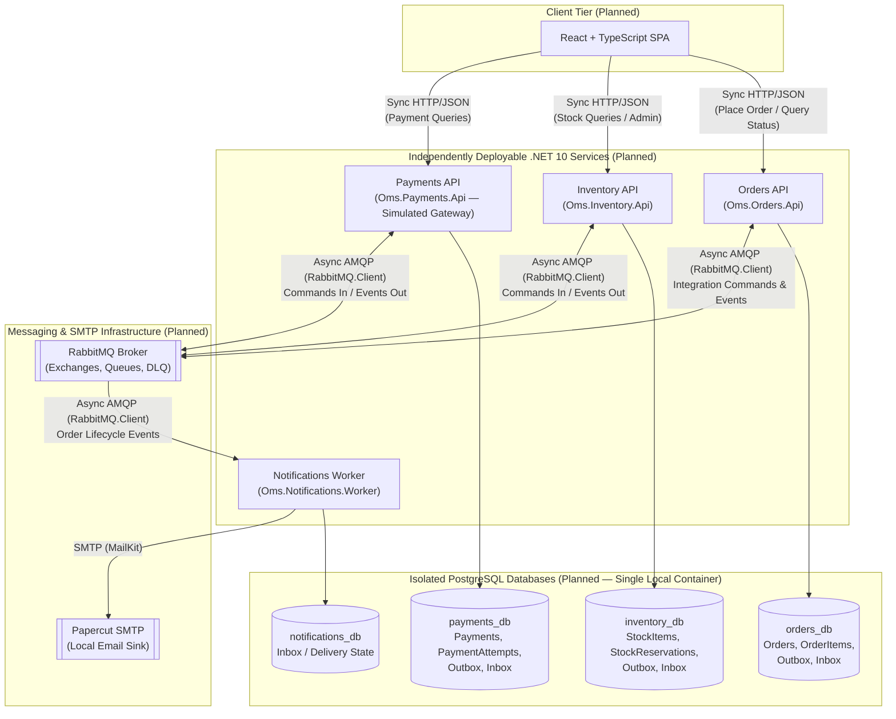

# Architecture Overview

## 1. Purpose & Current Implementation Status

OMS is an educational Order Management System designed to develop and demonstrate senior-level software engineering competencies in modern .NET 10 distributed SaaS applications.

> **Current Implementation Status**:
> - **Implemented**: Repository engineering baseline (`Oms.slnx`, `Directory.Build.props`, `Directory.Packages.props`, `.editorconfig`), documentation, Devin AI agent workflow, and the minimal `Orders` HTTP host scaffold (`Oms.Orders.Api` with `GET /health/live`, `Oms.Orders.UnitTests`, and `Oms.Orders.IntegrationTests`).
> - **Planned (Not Yet Implemented)**: All business domain models, application handlers, PostgreSQL databases, RabbitMQ messaging topology, Papercut SMTP integration, Docker Compose orchestration, the `Inventory`, `Payments`, and `Notifications` services, and the React frontend described below represent the **approved target architecture**. No business functionality or infrastructure exists yet.

---

## 2. Approved Architectural Baseline ([ADR-0001](adr/0001-independent-service-boundaries.md))

The following architectural decisions have been approved by the human engineer and recorded in [ADR-0001](adr/0001-independent-service-boundaries.md):

1. **Four Independently Deployable Services**:
   - **Orders (`Oms.Orders.Api`)** — ASP.NET Core Web API
   - **Inventory (`Oms.Inventory.Api`)** — ASP.NET Core Web API
   - **Payments (`Oms.Payments.Api`)** — ASP.NET Core Web API (using simulated payment processing)
   - **Notifications (`Oms.Notifications.Worker`)** — .NET Background Worker (sending emails via `MailKit` and `Papercut SMTP`)
2. **Incremental Implementation**: Services are built, tested, and verified one service at a time.
3. **Strict Service Boundaries & Data Ownership**:
   - No shared domain entities across services.
   - No cross-service database relationships, foreign keys, or shared tables.
   - Independent logical PostgreSQL databases per service (`orders_db`, `inventory_db`, `payments_db`, and `notifications_db` where persistent state is required).
   - During local development, a single PostgreSQL container may host these isolated databases.
4. **Single Deployable Assembly per Service with Logical Layers (Option B)**:
   - Each service is a single deployable project with internal Clean Architecture layers (`Domain`, `Application`, `Infrastructure`, `Api` / `Worker`) enforced by namespace boundaries, `internal` visibility, and automated architecture tests in `*.UnitTests`.
5. **Orders-Mediated Process Coordination (Option 1)**:
   - `Orders` coordinates the order fulfilment lifecycle by issuing asynchronous integration commands (`ReserveStock`, `RequestPayment`, `CommitStock`, `ReleaseStock`), reacting to integration events (`StockReserved`, `StockReservationFailed`, `PaymentSucceeded`, `PaymentFailed`), and publishing order lifecycle integration events (`OrderPlaced`, `OrderConfirmed`, `OrderCancelled`).
6. **Zero Shared Projects Initially**:
   - Service 1 (`Orders`) starts with zero shared `.csproj` libraries. Integration message contract packaging will be reconsidered when `Inventory` is introduced.
7. **Technology Constraints & Explicit Exclusions**:
   - .NET 10 / C# 14, Entity Framework Core, PostgreSQL, MediatR for in-process CQRS, `RabbitMQ.Client` for asynchronous messaging, `Microsoft.Extensions.Http.Resilience` for outgoing `.NET HttpClient` resilience, OpenTelemetry, xUnit + Testcontainers, Docker & Docker Compose (and Redis / Kubernetes in later stages).
   - **Explicitly Excluded**: **.NET Aspire**, **MassTransit**, and **direct Polly API usage**.

---

## 3. System Topology Diagram (Planned Architecture)



---

## 4. Service Boundary Definitions

### 4.1 Orders Service (`Oms.Orders.Api`) — ASP.NET Core API

- **Primary Responsibilities**:
  - Accept and validate customer order placement requests (`POST /api/orders`) and expose order status queries (`GET /api/orders/{id}`).
  - Own the `Order` lifecycle state machine (`Pending -> AwaitingStock -> AwaitingPayment -> Confirmed`, or `Cancelled` / `Failed`).
  - Act as the **process coordinator** for order fulfilment: send integration commands (`ReserveStock`, `RequestPayment`, `CommitStock`, `ReleaseStock`) and react to inventory and payment outcome events.
- **Explicitly Excluded Responsibilities**:
  - Tracking warehouse stock levels or managing inventory reservations directly.
  - Executing payment authorisations or storing payment gateway audit logs.
  - Formatting or dispatching customer emails.
- **Data Ownership (`orders_db`)**:
  - `orders` and `order_items` tables, plus `outbox_messages` and `inbox_messages` tables.
- **Minimal Anticipated Domain Model**:
  - `Order` (Aggregate Root): `Id`, `CustomerId`, `CustomerEmail`, `Status`, `TotalAmount`, `Currency`, `FailureReason`, `CreatedAtUtc`, `RowVersion` (optimistic concurrency), and a `1..N` collection of `OrderItem`.
  - `OrderItem` (Child Entity within `Order` aggregate): `Id`, `OrderId`, `ProductSku`, `Quantity`, `UnitPrice` (snapshotted at order creation).
- **Expected External Dependencies**:
  - PostgreSQL (`orders_db` via EF Core), RabbitMQ (`RabbitMQ.Client`), OpenTelemetry.
- **Initial Communication Requirements**:
  - **Inbound Sync HTTP**: Client endpoints for placing orders (`202 Accepted` or `201 Created` with initial `AwaitingStock` / `Pending` status) and querying order state.
  - **Outbound Async RabbitMQ (via Outbox)**:
    - *Integration Commands*: `ReserveStock`, `RequestPayment`, `CommitStock`, `ReleaseStock`.
    - *Integration Events*: `OrderPlaced`, `OrderConfirmed`, `OrderCancelled`.
  - **Inbound Async RabbitMQ (via Inbox)**:
    - *Integration Events*: `StockReserved`, `StockReservationFailed`, `PaymentSucceeded`, `PaymentFailed`.
- **Failure & Consistency Considerations**:
  - Order creation and the initial Outbox messages (`OrderPlaced` / `ReserveStock`) commit atomically in a single `orders_db` transaction.
  - State transitions on `Order` are idempotent and guarded against duplicate or out-of-order messages (for example, ignoring a duplicate `StockReserved` event if the order has already advanced to `AwaitingPayment`).

### 4.2 Inventory Service (`Oms.Inventory.Api`) — ASP.NET Core API

- **Primary Responsibilities**:
  - Maintain authoritative stock quantities for products (`StockItem`).
  - Reserve stock when instructed by `ReserveStock`, commit reservations on `CommitStock`, and release reservations on `ReleaseStock`.
  - Expose HTTP endpoints for querying stock availability and seeding/adjusting stock in development/testing.
- **Explicitly Excluded Responsibilities**:
  - Knowing customer identity, order monetary totals, payment status, or email notifications.
- **Data Ownership (`inventory_db`)**:
  - `stock_items` and `stock_reservations` tables, plus `outbox_messages` and `inbox_messages` tables.
- **Minimal Anticipated Domain Model**:
  - `StockItem` (Aggregate Root): `Id`, `ProductSku` (unique), `QuantityAvailable`, `QuantityReserved`, `RowVersion` (optimistic concurrency). Enforces the invariant `QuantityAvailable >= 0` and `QuantityReserved >= 0`.
  - `StockReservation` (Child Entity, `1..N` from `StockItem`): `Id`, `StockItemId`, `OrderId`, `Quantity`, `Status` (`Reserved`, `Committed`, `Released`), `CreatedAtUtc`.
- **Expected External Dependencies**:
  - PostgreSQL (`inventory_db` via EF Core), RabbitMQ (`RabbitMQ.Client`), OpenTelemetry (and Redis in a later caching stage).
- **Initial Communication Requirements**:
  - **Inbound Sync HTTP**: Read/admin endpoints (`GET /api/stock/{sku}`, `POST /api/stock`) for inspection and test setup.
  - **Inbound Async RabbitMQ (via Inbox)**:
    - *Integration Commands*: `ReserveStock`, `CommitStock`, `ReleaseStock`.
  - **Outbound Async RabbitMQ (via Outbox)**:
    - *Integration Events*: `StockReserved`, `StockReservationFailed`, `StockReservationCommitted`, `StockReleased`.
- **Failure & Consistency Considerations**:
  - Concurrent reservations for the same SKU are protected by optimistic concurrency (`xmin` / row version) and database `CHECK` constraints (`quantity_available >= 0` and `quantity_reserved >= 0`) so overselling is impossible under race conditions.
  - Reservation handling is idempotent by `(OrderId, ProductSku)`: reprocessing `ReserveStock` for an order that already holds an active reservation republishes/returns the existing outcome without double-deducting stock.

### 4.3 Payments Service (`Oms.Payments.Api`) — ASP.NET Core API

- **Primary Responsibilities**:
  - Execute simulated payment authorisation/capture when instructed by `RequestPayment`.
  - Record an immutable audit trail of every payment attempt (`PaymentAttempt`).
  - Expose read-only HTTP endpoints to inspect payment status by `OrderId` or `PaymentId`.
- **Explicitly Excluded Responsibilities**:
  - Managing order line items, reserving warehouse stock, or sending emails.
- **Data Ownership (`payments_db`)**:
  - `payments` and `payment_attempts` tables, plus `outbox_messages` and `inbox_messages` tables.
- **Minimal Anticipated Domain Model**:
  - `Payment` (Aggregate Root): `Id`, `OrderId` (unique idempotency key per order), `Amount`, `Currency`, `Status` (`Pending`, `Succeeded`, `Failed`, `Refunded`), `CreatedAtUtc`, `RowVersion`, and a `1..N` collection of `PaymentAttempt`.
  - `PaymentAttempt` (Child Entity within `Payment` aggregate): `Id`, `PaymentId`, `AttemptNumber`, `Status` (`Succeeded`, `Declined`, `GatewayError`), `FailureReason`, `AttemptedAtUtc`.
- **Expected External Dependencies**:
  - PostgreSQL (`payments_db` via EF Core), RabbitMQ (`RabbitMQ.Client`), deterministic/configurable simulated payment gateway, OpenTelemetry.
- **Initial Communication Requirements**:
  - **Inbound Sync HTTP**: Read endpoints (`GET /api/payments/order/{orderId}`) for status inspection.
  - **Inbound Async RabbitMQ (via Inbox)**:
    - *Integration Command*: `RequestPayment` (`OrderId`, `Amount`, `Currency`).
  - **Outbound Async RabbitMQ (via Outbox)**:
    - *Integration Events*: `PaymentSucceeded`, `PaymentFailed`.
- **Failure & Consistency Considerations**:
  - **Strict Idempotency on `OrderId`**: If `RequestPayment` is redelivered after a payment has already succeeded, `Payments` must not charge the customer twice; the Inbox and unique constraint on `OrderId` ensure duplicate messages are safely acknowledged.
  - Transient simulated gateway errors are recorded as `PaymentAttempt` entries before retrying, whereas deterministic declines (e.g. insufficient funds) immediately transition `Payment` to `Failed` and emit `PaymentFailed`.

### 4.4 Notifications Service (`Oms.Notifications.Worker`) — Background Worker

- **Primary Responsibilities**:
  - Consume terminal order lifecycle integration events (`OrderConfirmed`, `OrderCancelled`) from RabbitMQ.
  - Render plain-text/HTML transactional emails and dispatch them via `MailKit` to `Papercut SMTP`.
- **Explicitly Excluded Responsibilities**:
  - Owning business domain aggregates, mutating order/stock/payment state, or exposing public business APIs.
- **Data Ownership (`notifications_db`)**:
  - Minimal persistence required strictly for reliable idempotent processing: `inbox_messages` (or `notification_dispatches`) tracking processed `MessageId`, `OrderId`, `NotificationType`, `RecipientEmail`, `SentAtUtc`, and `Status`.
- **Minimal Anticipated Domain Model**:
  - **No mandatory DDD aggregates or domain entities**. Uses a lightweight persistence record (`NotificationDispatch` / `InboxMessage`) to prevent duplicate email dispatch on message redelivery and to record delivery status.
- **Expected External Dependencies**:
  - RabbitMQ (`RabbitMQ.Client`), Papercut SMTP (`MailKit`), PostgreSQL (`notifications_db` for Inbox deduplication), OpenTelemetry.
- **Initial Communication Requirements**:
  - **Inbound Async RabbitMQ (via Inbox)**:
    - *Integration Events*: `OrderConfirmed`, `OrderCancelled`.
  - **Outbound SMTP**: Sends email over SMTP to Papercut SMTP.
- **Failure & Consistency Considerations**:
  - SMTP delivery cannot participate in a PostgreSQL transaction. The worker checks `notifications_db` first, sends the email via `MailKit`, and then records the message as processed. If the process crashes in the narrow window after SMTP acceptance but before database commit, a retry may send a duplicate email—an inherent trade-off of at-least-once delivery over external SMTP that is explicitly accepted and minimised.

---

## 5. Physical Solution Structure (Approved Option B)

> **Status**: **Accepted** ([ADR-0001](adr/0001-independent-service-boundaries.md)). Projects will be created incrementally one service at a time starting in Task 003.

### Architectural Rationale

Each service in OMS is an independent runtime. Internal code organisation within each service balances Clean Architecture separation against project sprawl and our strict build baseline (`<TreatWarningsAsErrors>true</TreatWarningsAsErrors>` and `<GenerateDocumentationFile>true</GenerateDocumentationFile>` **without** `CS1591` suppression).

In .NET, every `public` or `protected` type across assembly boundaries requires XML documentation comments (`///`) or fails compilation with `CS1591`. Conversely, `internal` types within an assembly do not trigger `CS1591`.

| Criterion | Option A (Rejected): 4 Assemblies per Service (`Domain`, `Application`, `Infrastructure`, `Api`) | Option B (Approved): Single Deployable Assembly per Service with Enforced Layer Namespaces |
| :--- | :--- | :--- |
| **Compile-Time Dependency Enforcement** | **MSBuild Project References**: `Domain.csproj` physically cannot reference EF Core, MediatR, or `RabbitMQ.Client`. | **Automated Architecture Tests**: Because folder structure alone does not enforce boundaries, layer rules (`Domain` must not reference `Application`, `Infrastructure`, `Api`, EF Core, or `RabbitMQ.Client`; `Application` must not reference `Infrastructure` or `Api`) are strictly enforced via automated architecture tests in `*.UnitTests` (see [`docs/TESTING.md`](TESTING.md)). |
| **Testability** | High, though requires making internal application/infrastructure types `public` across assembly boundaries. | High: `InternalsVisibleTo` grants `Oms.<Service>.UnitTests` and `Oms.<Service>.IntegrationTests` full access to `internal` domain and application types. |
| **Maintainability & `CS1591` Impact** | **High Friction**: Because types crossing assembly boundaries must be `public`, every entity, repository interface, command, handler, and DTO must carry `///` XML comments to satisfy `CS1591` under `TreatWarningsAsErrors=true`. | **High Maintainability**: Domain entities, value objects, MediatR handlers, EF Core configurations, and Outbox/Inbox classes remain `internal`. Only genuine public API contracts require XML documentation. |
| **Build & Solution Complexity** | **Heavy**: 4 services x 4 layers + 8 test projects = **24 `.csproj` files** for a small educational system. | **Minimal & Fast**: 4 deployable service projects + 2 test projects per service = **12 `.csproj` files** total at full completion (and only **3 `.csproj` files** when building the first service). |
| **Educational Value** | Demonstrates traditional multi-project Clean Architecture diagrams. | Demonstrates senior-level judgement: separating **logical architecture** (Clean Architecture layers) from **physical packaging** (assemblies), encapsulation via `internal`, and automated architecture fitness functions. |
| **Future Evolution** | Harder to refactor across layers due to rigid project references. | If a service's domain later grows complex enough to warrant its own assembly, extracting `Domain/` into `Oms.<Service>.Domain.csproj` is a straightforward mechanical refactoring because namespace boundaries are already clean. |

### Shared Projects Policy (Approved)

- **No Shared Domain Model**: Domain entities and value objects are never shared across services.
- **Zero Shared Projects Initially**: Service 1 (`Orders`) is implemented with zero shared `.csproj` libraries (no `Oms.Common`, `Oms.BuildingBlocks`, or `Oms.Contracts`).
- **Deferred Contract Packaging Decision**: When the second service (`Inventory`) is introduced, we will evaluate whether to keep small local message contract records per service (tolerant reader pattern) or introduce a dependency-free `Oms.Contracts` project.

### Approved Target Solution Tree

*(Note: No `.csproj` projects are created in TASK 002. Services and their test projects will be added incrementally one service at a time.)*

```text
Oms.slnx
├── Directory.Build.props
├── Directory.Packages.props
├── .editorconfig
├── docs/
│   ├── ARCHITECTURE.md
│   ├── ENGINEERING.md
│   ├── TESTING.md
│   ├── AI-WORKFLOW.md
│   └── adr/
│       ├── README.md
│       └── 0001-independent-service-boundaries.md
├── src/                                      # (Planned — added incrementally per service)
│   ├── Orders/
│   │   └── Oms.Orders.Api/
│   │       ├── Domain/                       # Order, OrderItem, OrderStatus, domain rules
│   │       ├── Application/                  # MediatR commands, queries, handlers, ports
│   │       ├── Infrastructure/               # OrdersDbContext, Outbox/Inbox, RabbitMQ consumers/publishers
│   │       └── Api/                          # Endpoints, HTTP contracts, Program.cs
│   ├── Inventory/
│   │   └── Oms.Inventory.Api/
│   │       ├── Domain/                       # StockItem, StockReservation
│   │       ├── Application/
│   │       ├── Infrastructure/               # InventoryDbContext, Outbox/Inbox, RabbitMQ
│   │       └── Api/
│   ├── Payments/
│   │   └── Oms.Payments.Api/
│   │       ├── Domain/                       # Payment, PaymentAttempt
│   │       ├── Application/
│   │       ├── Infrastructure/               # PaymentsDbContext, SimulatedGateway, Outbox/Inbox, RabbitMQ
│   │       └── Api/
│   └── Notifications/
│       └── Oms.Notifications.Worker/
│           ├── Application/                  # Notification handlers & email templates
│           ├── Infrastructure/               # NotificationsDbContext (Inbox), MailKit SMTP, RabbitMQ
│           └── Worker/                       # BackgroundService host, Program.cs
└── tests/                                    # (Planned — added alongside each service)
    ├── Orders/
    │   ├── Oms.Orders.UnitTests/             # Domain logic, handler tests, & layer architecture checks
    │   └── Oms.Orders.IntegrationTests/      # Testcontainers (PostgreSQL + RabbitMQ)
    ├── Inventory/
    │   ├── Oms.Inventory.UnitTests/
    │   └── Oms.Inventory.IntegrationTests/
    ├── Payments/
    │   ├── Oms.Payments.UnitTests/
    │   └── Oms.Payments.IntegrationTests/
    └── Notifications/
        ├── Oms.Notifications.UnitTests/
        └── Oms.Notifications.IntegrationTests/
```

---

## 6. Communication, Consistency, and Failure Strategy

### 6.1 Synchronous HTTP vs Asynchronous Messaging & Resilience Scope

- **Synchronous HTTP (Edge Communication)**:
  - Used between external clients (React SPA, API callers, test harnesses) and the ASP.NET Core APIs (`Orders`, `Inventory`, `Payments`) where an immediate response (`200 OK`, `201 Created`, `202 Accepted`, `400 Bad Request`, `404 Not Found`) is required.
- **Scope of `Microsoft.Extensions.Http.Resilience`**:
  - `Microsoft.Extensions.Http.Resilience` configures resilience pipelines (retries, timeouts, circuit breakers, hedging) on **outgoing HTTP calls made by `.NET HttpClient` instances** (for example, if a .NET service calls an external HTTP payment gateway, webhook, or downstream HTTP endpoint, or in `.NET` integration test/client harnesses).
  - It does **not** automatically protect incoming ASP.NET Core API requests (which rely on ASP.NET Core server timeouts, rate limiting, and validation) and does **not** run inside the React browser client (which manages its own fetch/HTTP retry semantics).
- **Asynchronous Messaging via RabbitMQ (Inter-Service Workflow)**:
  - Cross-service business workflows (`Orders` <-> `Inventory` <-> `Payments` -> `Notifications`) communicate **asynchronously over RabbitMQ** (`RabbitMQ.Client`) rather than via synchronous service-to-service HTTP chains.
  - **Rationale**: Synchronous HTTP chains across `Orders -> Inventory -> Payments` introduce temporal coupling (all three services must be healthy simultaneously to accept an order), amplify tail latency, and create partial-failure states when a network timeout occurs after a downstream database commit.

### 6.2 Domain Events, Integration Events, and Integration Commands

We distinguish strictly between **in-process domain events** and **cross-service integration messages** (which are further divided into **integration commands** and **integration events**):

| Message Category | Intent & Naming | Scope & Transport | Ownership & Routing | Examples |
| :--- | :--- | :--- | :--- | :--- |
| **Domain Event** | Imperative fact inside a single aggregate/bounded context (past-tense verb). | **In-process only** within the owning service assembly. Never published directly to RabbitMQ. | Owned by the service's `Domain` layer (`internal` C# record). | `OrderCreatedDomainEvent` |
| **Integration Command** | Asynchronous instruction asking **one specific target service** to perform an action (imperative verb). | Cross-process over AMQP (`RabbitMQ.Client`), persisted via the sender's **Transactional Outbox**. | Routed to a single target service's command queue. | `ReserveStock`, `CommitStock`, `ReleaseStock`, `RequestPayment` |
| **Integration Event** | Asynchronous notification broadcasting a **committed business fact** to one or more interested services (past-tense verb). | Cross-process over AMQP (`RabbitMQ.Client`) via a topic exchange (e.g. `oms.events`), persisted via the publisher's **Transactional Outbox**. | Published by the service that owns the state change; consumed by any interested subscriber queue. | `OrderPlaced`, `StockReserved`, `StockReservationFailed`, `PaymentSucceeded`, `PaymentFailed`, `OrderConfirmed`, `OrderCancelled` |

### 6.3 Explicit Transaction Boundaries (`MediatR`, EF Core, and the Outbox)

- **`MediatR` Does Not Provide Automatic Transactions**:
  - `MediatR` is purely an in-process request/notification dispatcher (`ISender` / `IPublisher`). Dispatching a command or domain event through `MediatR` does **not** automatically open, share, or commit a database transaction.
- **Explicit Unit-of-Work & Atomic Outbox Persistence**:
  - Every state-mutating application command handler (or a dedicated EF Core transaction pipeline behaviour wrapping the handler) operates within a single local `DbContext` transaction boundary.
  - If in-process domain events are used, their handlers must execute **before** `DbContext.SaveChangesAsync` (or inside an explicit `Database.BeginTransactionAsync` / `IDbContextTransaction.CommitAsync` scope) so that all aggregate state changes, domain side-effects, and outgoing `OutboxMessage` records are staged on the same `DbContext`.
  - A single `DbContext.SaveChangesAsync` call (or explicit transaction commit) atomically persists both the **business state mutation** (e.g. inserting `Order` and `OrderItem` rows, or updating `Order.Status`) and the **serialised integration commands/events** in `outbox_messages` (plus any `inbox_messages` deduplication entry when triggered by a message consumer).
  - If the database transaction rolls back, neither the aggregate state change nor the `OutboxMessage` is persisted, eliminating dual-write inconsistencies by construction.

### 6.4 Why RabbitMQ and Kafka Are Not Interchangeable (No Broker-Agnostic Abstraction)

A common architectural mistake is designing a generic `IMessageBroker` interface that pretends RabbitMQ and Apache Kafka are drop-in replacements:

- **Fundamental Semantic Differences**:
  - **RabbitMQ** is a smart message broker built around exchanges, routing keys, queues, competing consumers, explicit per-message acknowledgements (`BasicAck` / `BasicNack`), TTLs, and Dead-Letter Exchanges (DLX). Once acknowledged, a message is removed from the queue.
  - **Kafka** is a distributed, partitioned append-only commit log where consumers track sequential partition offsets, messages are retained after consumption for replay, and ordering is guaranteed per partition key rather than via routing topologies and per-message acks.
- **Pragmatic Approach for OMS**:
  - Do **not** build a speculative "broker-agnostic" framework that hides AMQP semantics.
  - Application handlers stage integration commands and events into the local EF Core Outbox within the unit of work, while the infrastructure layer implements the Outbox publisher and Inbox consumers directly and transparently against `RabbitMQ.Client` v7+ (`IConnection`, `IChannel`, publisher confirms, `AsyncEventingBasicConsumer`, and explicit DLX configuration).

### 6.5 Transactional Outbox, Inbox, Retries, and Dead-Letter Handling

1. **Transactional Outbox (Producer Reliability)**:
   - Command and event handlers stage `OutboxMessage` rows (`Id`, `MessageType`, `Payload`, `CorrelationId`, `CreatedAtUtc`, `ProcessedAtUtc`) in the same PostgreSQL transaction as the aggregate changes.
   - A background worker (`OutboxProcessor`) in the service polls unprocessed `outbox_messages` rows (using `FOR UPDATE SKIP LOCKED`), publishes them to RabbitMQ with publisher confirmations enabled, and records `ProcessedAtUtc`.
2. **Idempotent Consumers & Transactional Inbox (Consumer Reliability)**:
   - RabbitMQ provides **at-least-once delivery**; any message can be delivered more than once.
   - When a consumer receives an integration command or event (`MessageId`), it opens a local database transaction, inserts `(MessageId, ConsumerName)` into `inbox_messages`, executes the domain/application logic, stages any resulting outgoing `outbox_messages`, commits the transaction, and only then calls `BasicAckAsync`.
   - If `(MessageId, ConsumerName)` already exists in `inbox_messages`, the consumer immediately acknowledges (`BasicAckAsync`) the duplicate message as a no-op.
3. **Retry and Dead-Letter Queue (DLQ) Strategy**:
   - **Transient Database / Network Errors**: Retried with exponential backoff inside the consumer or requeued up to a bounded retry count (e.g. 3 attempts).
   - **Poison / Unprocessable Messages**: If a message fails deserialisation, violates an unrecoverable invariant, or exhausts its retry budget, the consumer rejects it without requeueing (`BasicNackAsync(requeue: false)`).
   - **Dead-Letter Exchange (DLX)**: Every service queue is configured with a Dead-Letter Exchange (`oms.dlx`) routing rejected messages to a dedicated `<queue_name>.dlq` for inspection, alerting, and manual replay—preventing infinite poison-message loops.

### 6.6 End-to-End Order Processing Scenario (Approved Orders-Mediated Flow)

#### Coordination Strategy: Orders-Mediated Process Coordination (Option 1 — Approved)

Rather than introducing a heavyweight Saga framework or coupling `Inventory` and `Payments` directly to each other's events, the `Order` aggregate in `Orders` acts as the **stateful process coordinator** via its status transitions (`Pending -> AwaitingStock -> AwaitingPayment -> Confirmed`, or `Cancelled` / `Failed`):

#### Happy Path Flow

1. **Place Order (`Orders`)**:
   - Client sends `POST /api/orders` with customer details and line items.
   - `Orders` creates an `Order` in `AwaitingStock` (or `Pending` -> `AwaitingStock`) status and atomically stages the `ReserveStock` integration command (`OrderId`, `Items`) and `OrderPlaced` integration event in `orders_db.outbox_messages` within the same EF Core transaction, returning `202 Accepted` (or `201 Created`) with the `OrderId`.
   - `Orders` Outbox publishes `ReserveStock` (and `OrderPlaced`) to RabbitMQ.
2. **Reserve Stock (`Inventory`)**:
   - `Inventory` consumes the `ReserveStock` command, records the message in `inventory_db.inbox_messages`, verifies `QuantityAvailable >= Quantity` for each requested SKU, creates `StockReservation` records (`Reserved`), deducts available stock, and stages the `StockReserved` integration event (`OrderId`) in `inventory_db.outbox_messages` in a single transaction.
   - `Inventory` Outbox publishes `StockReserved`.
3. **Request & Process Payment (`Orders` -> `Payments`)**:
   - `Orders` consumes `StockReserved`, transitions `Order` from `AwaitingStock` to `AwaitingPayment`, and stages the `RequestPayment` integration command (`OrderId`, `TotalAmount`, `Currency`) in `orders_db.outbox_messages` in a single transaction.
   - `Payments` consumes `RequestPayment`, creates a `Payment` record (`Pending`), invokes the simulated payment gateway, records a `PaymentAttempt` (`Succeeded`), transitions `Payment` to `Succeeded`, and stages the `PaymentSucceeded` integration event (`OrderId`, `PaymentId`) in `payments_db.outbox_messages`.
4. **Confirm Order, Commit Stock & Notify (`Orders` -> `Inventory` & `Notifications`)**:
   - `Orders` consumes `PaymentSucceeded`, transitions `Order` to `Confirmed`, and atomically stages both the `CommitStock` integration command (`OrderId`) and the `OrderConfirmed` integration event (`OrderId`, `CustomerEmail`, `TotalAmount`) in `orders_db.outbox_messages`.
   - `Inventory` consumes `CommitStock` and transitions the corresponding `StockReservation` records from `Reserved` to `Committed`.
   - `Notifications` consumes `OrderConfirmed`, checks `notifications_db.inbox_messages`, sends the order confirmation email via `MailKit` to `Papercut SMTP`, and records the dispatch in `notifications_db`.

#### Failure & Compensation Scenarios

| Failure Scenario | System Behaviour & Recovery |
| :--- | :--- |
| **1. Insufficient Stock** | `Inventory` cannot fulfil one or more line items in `ReserveStock`. It rolls back any partial reservation in memory, stages `StockReservationFailed` (`OrderId`, `Reason: InsufficientStock`) in `inventory_db.outbox_messages`, and commits. `Orders` consumes `StockReservationFailed`, transitions `Order` to `Cancelled`, and stages `OrderCancelled` in `orders_db.outbox_messages`. `Notifications` consumes `OrderCancelled` and sends a cancellation email. `RequestPayment` is never issued. |
| **2. Payment Declined (Compensating Stock Release)** | Stock was reserved in `Inventory`, but `Payments` declines `RequestPayment` and emits `PaymentFailed` (`OrderId`, `Reason: CardDeclined`). `Orders` consumes `PaymentFailed`, transitions `Order` to `Cancelled`, and atomically stages both the `ReleaseStock` integration command (`OrderId`) and the `OrderCancelled` integration event in `orders_db.outbox_messages`. `Inventory` consumes `ReleaseStock`, transitions the `StockReservation` for `OrderId` to `Released`, restores `QuantityAvailable`, and emits `StockReleased`. `Notifications` consumes `OrderCancelled` and sends a cancellation email. |
| **3. Duplicate Message Delivery** | RabbitMQ redelivers `ReserveStock`, `StockReserved`, `RequestPayment`, or `PaymentSucceeded` (e.g. due to a consumer restart before `BasicAck`). The receiving service's Inbox (`(MessageId, ConsumerName)` unique constraint) and aggregate status guards detect the duplicate within the database transaction and acknowledge the message without double-reserving stock, double-charging payment, or emitting duplicate commands. |
| **4. RabbitMQ Broker Temporarily Unavailable** | Services continue accepting local work (`Orders` still accepts `POST /api/orders` and commits to `orders_db`). Outbox messages remain queued in PostgreSQL (`ProcessedAtUtc IS NULL`) and are automatically published once `OutboxProcessor` reconnects to RabbitMQ. |
| **5. Papercut SMTP Temporarily Unavailable** | `Notifications` fails to send via `MailKit`, does not mark the Inbox record as completed, and retries with backoff. If retries are exhausted, the message moves to `notifications.dlq` without affecting the already-`Confirmed` order in `Orders`. |

---

## 7. Deferred Architectural Decisions (For Future Tasks)

All foundational decisions required to begin implementing Service 1 (`Orders`) have been approved ([ADR-0001](adr/0001-independent-service-boundaries.md)). The following items are intentionally deferred to later implementation stages:

1. **Integration Contract Packaging (When `Inventory` Is Introduced)**: Reassess whether to retain local message contract records per service or extract a dependency-free `Oms.Contracts` project once the second service is implemented.
2. **Stale Reservation / Order Timeout Escalation**: Evaluating a scheduled timeout check for orders stuck in `AwaitingStock` or `AwaitingPayment` once basic asynchronous messaging is operational.
3. **Redis Caching & Kubernetes Deployment Manifests**: Deferred to dedicated later tasks in the project roadmap.
